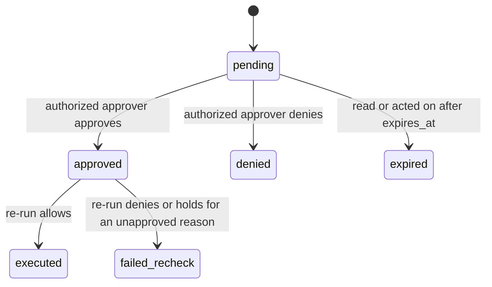

# Design: Audit, Proxy Flow, and Approvals

## Overview
`src/server` orchestrates I/O around the pure core. The key function is `runGuardedRequest()`, which every entry point uses: the HTTP API, the approvals re-run, the scripted agent, and the MCP server. One function means one set of security guarantees.

```mermaid
sequenceDiagram
  participant A as Agent
  participant R as /api/v1/pay
  participant S as runGuardedRequest
  participant DB as Postgres
  participant P as evaluate() (pure)
  participant RL as Rail adapter
  A->>R: POST (Bearer key, Idempotency-Key)
  R->>S: parsed request
  S->>DB: BEGIN; SELECT envelope FOR UPDATE
  S->>DB: idempotency lookup / claim (PXY-8, PXY-12, PXY-14)
  S->>DB: load frozen flag, window, session, scope
  S->>P: evaluate(...)
  P-->>S: Decision
  S->>DB: appendEvent(decision); reserve if allow; freeze if VELOCITY_EXCEEDED; create approval if hold
  S->>DB: COMMIT
  alt decision = allow
    S->>RL: execute(idempotencyKey)
    RL-->>S: result
    S->>DB: appendEvent(rail_result); settle / release / keep reservation; store idempotency response
  end
  S-->>R: result
  R-->>A: 200 / 202 held or unknown / 403 deny
```

**Why commit before calling the rail?** Holding a row lock across a network call to a blockchain facilitator could take seconds and block every other request for that agent. Instead, the decision transaction also inserts a `spend_reservations` row for the amount, so concurrent requests see it in the window state (RES-1, RES-2, PXY-9). See [Reservations and rail outcomes](#reservations-and-rail-outcomes).

**Frozen agents (PXY-11).** The `AGENT_FROZEN` deny rule already exists in money-and-policy-core (ENV-5, `frozenRule`), which reads `SessionState.agentFrozen` (taint-and-intent design). This spec only loads the input: `runGuardedRequest` reads `agents.frozen_at` after it holds the envelope lock and sets `agentFrozen = frozen_at !== null`. A freeze set by a concurrent request (PXY-10) commits while that request holds the same envelope lock, so the next request always sees it. The approvals re-run goes through the same path, so approving a request from an agent that was frozen in the meantime ends in `failed_recheck` (HITL-3).

## Database schema (Drizzle, Postgres)
All money columns are `bigint` with `mode: "bigint"`.

| Table | Key columns |
|---|---|
| `workspaces` | `id`, `name`, `is_sandbox`, `owner_user_id`, `created_at`, `retired_at` |
| `users` / Auth.js tables | Standard Auth.js Drizzle adapter tables |
| `agents` | `id`, `workspace_id`, `name`, `api_key_hash` (unique), `frozen_at`, `revoked_at` |
| `envelopes` | `agent_id` (PK), `limits` (jsonb, amounts as strings), `vendor_limits`, `tool_limits`, `allowed_vendors`, `allowed_tools`, `version` |
| `tasks` | `id`, `workspace_id`, `description`, `allowed_vendor_categories`, `allowed_tools`, `budget_micros` |
| `sessions` | `id`, `agent_id`, `task_id`, `tainted_at`, `taint_source_url`, `taint_content_sha256` |
| `vendors` | `id`, `workspace_id`, `origin`, `category`, `trusted` |
| `spend_reservations` | `id`, `agent_id`, `session_id`, `vendor`, `tool`, `amount_micros`, `status` (`reserved`/`settled`/`released`), `rail`, `rail_idempotency_key`, `decision_seq`, `created_at`, `resolved_at` |
| `idempotency` | (`agent_id`, `key`) PK, `request_hash`, `response` jsonb (null while in progress), `created_at` |
| `approvals` | `id`, `workspace_id`, `request` jsonb, `reasons` jsonb, `status` (`pending`/`approved`/`denied`/`expired`/`failed_recheck`/`executed`), `expires_at`, `decided_by`, `decided_at` |
| `audit_events` | `workspace_id`, `seq` (PK together), `type`, `payload` jsonb, `prev_hash`, `hash`, `created_at` (`timestamptz(3)`) |
| `audit_heads` | `workspace_id` (PK), `seq`, `hash`, `mac`, `updated_at` |
| `rate_limits` | (`key`, `window_start`) PK, `count` |

Indexes: `spend_reservations (agent_id, created_at)`, `spend_reservations (session_id)` for task budgets, `spend_reservations (status, created_at) WHERE status = 'reserved'` for the reconciler, `idempotency (agent_id, created_at)` for call counts and cleanup. The `audit_events` primary key already covers (`workspace_id`, `seq`).

- **Workspace members:** a workspace has one member, its `owner_user_id`. "Signed-in member of the workspace" means the owner. Shared workspaces are out of scope.
- **Rate limits:** `rate_limits` holds the per-IP fixed windows for sandbox actions (telemetry-dashboard UI-4). The key is a SHA-256 of the IP plus the action, so raw IPs are never stored.

Append-only triggers (AUD-3):
```sql
CREATE FUNCTION audit_events_block_mutation() RETURNS trigger AS $$
BEGIN RAISE EXCEPTION 'audit_events is append-only'; END $$ LANGUAGE plpgsql;

CREATE TRIGGER audit_events_no_update BEFORE UPDATE OR DELETE ON audit_events
  FOR EACH ROW EXECUTE FUNCTION audit_events_block_mutation();

-- Row-level triggers never fire on TRUNCATE, so it needs its own statement-level trigger.
CREATE TRIGGER audit_events_no_truncate BEFORE TRUNCATE ON audit_events
  FOR EACH STATEMENT EXECUTE FUNCTION audit_events_block_mutation();
```
Tamper tests drop the triggers on a throwaway test database to simulate an attacker with database access. The chain head (below) covers the case the triggers can't: an attacker who drops them and deletes rows from the end of the chain.

## Reservations and rail outcomes
Each reservation stores the rail and the rail idempotency key, so the reconciler can resolve it later without the original request (RES-8). The rail idempotency key is the reservation ID, not the client's `Idempotency-Key`. A client key reused after 24 hours (PXY-13) therefore can't collide with an old payment on the rail.

| Rail outcome | Class | `rail_result.status` | Reservation | HTTP |
|---|---|---|---|---|
| `ok: true` | confirmed success | `settled` | `settled` (RES-3) | 200 |
| `BELOW_RAIL_MINIMUM`, `CHALLENGE_MISMATCH`, `RAIL_REJECTED` | confirmed failure | `failed` | `released` (RES-4) | 502 with the typed code |
| `RAIL_TIMEOUT`, `INVALID_RAIL_RESPONSE`, an exception thrown after the request was sent | unknown | `unknown` | stays `reserved` (RES-5) | 202 with `rail_status: "unknown"` |
| The process dies before the `rail_result` is written | unknown (no event) | none yet | stays `reserved` | none |

`INVALID_RAIL_RESPONSE` counts as unknown because an unreadable response does not prove the vendor didn't charge. If the rail-adapters spec later makes any failure code ambiguous, it moves to the unknown row. The classification lives in one pure function, `classifyRailResult(result): "settled" | "failed" | "unknown"`, in `src/server/payments/outcome.ts`, so it can be unit-tested without a database.

Window state sums `reserved` and `settled` reservations whose `created_at` falls inside each window (RES-2). Session spend for the task budget (taint-and-intent INT-4) sums the same reservations by `session_id`.

`callsLastMinute` (ENV-3) counts the agent's `idempotency` rows created in the last minute, excluding this request. Every pay or tool request claims one row, including denied and held ones, so a retry loop counts even after it starts getting denied. Replays of the same key don't add a row, so they don't count.

Tools with no rail (for example `payee.update`) still go through the full flow. On `allow` there is no rail call: the system writes a `rail_result` with `status: "settled"` and `rail: null`, and no reservation is created, because no money moves. An unresolved reservation counts exactly like a settled one. This replaces the earlier "treat as spent after 10 minutes" rule, because a reservation now counts from the moment it is created.

**Reconciler** (`src/server/payments/reconcile.ts`, RES-6 to RES-9):
- Triggers. Vercel Hobby allows cron jobs only once per day (with ±59 minutes of jitter), and more frequent expressions fail at deploy time. So the reconciler runs in three ways:
  1. After each pay or tool request, the handler uses Next.js `after()` to reconcile up to 5 of that agent's stale reservations once the response is sent. The agent's own traffic clears its backlog without slowing the response.
  2. A Vercel Cron route (`/api/cron/reconcile`, protected by `CRON_SECRET`) runs daily on Hobby, or every 5 minutes on Pro.
  3. `pnpm reconcile` runs it by hand.
- Selects reservations still `reserved` 10 minutes after creation. The rail timeout is 30 seconds, so by then the original request has either written a `rail_result` or died. It locks each one with `FOR UPDATE SKIP LOCKED`, so two runs can't resolve the same reservation.
- Asks the adapter for the outcome with `lookup(railIdempotencyKey)` (rail-adapters RAIL-21, RAIL-22). `lookup` is read-only, so the reconciler can never start a new payment (RES-8).
- On a confirmed result, in one transaction: appends `rail_result` with `reconciled: true` and `decision_seq`, sets the reservation to `settled` or `released`, and rewrites the `idempotency.response` (RES-9).
- If the outcome is still unknown, it changes nothing and logs the attempt (RES-7). `pnpm reconcile` also lists reservations still unknown after 24 hours for manual review. Listing never releases anything.

## Idempotency
Each agent has its own idempotency keys (PXY-8, PXY-12 to PXY-14).

- `request_hash` = `sha256(canonicalJson(body))` over the validated request body (`vendor`, `tool`, `amount_micros`, `session_id`) using the CJ rules. The hash uses the parsed body, so key order and whitespace in the client's JSON don't matter.
- A record is "live" if `created_at > now() - interval '24 hours'`. Lookups ignore records that aren't live. The reconciler cron also deletes records older than 24 hours. These are operational rows, not audit events.
- After the envelope lock, in the same transaction:
  1. If no live row exists, delete any expired row for that key, then insert `(agent_id, key, request_hash, response: null)`. The row is claimed in the decision transaction, so a concurrent duplicate can't evaluate twice.
  2. If a live row has a different `request_hash`, return **422** `IDEMPOTENCY_KEY_REUSED` with no evaluation and no audit event.
  3. If a live row has a matching hash and `response` is null, return **409** `IDEMPOTENCY_IN_PROGRESS`.
  4. If a live row has a matching hash and a response, return the stored response.
- For `hold` and `deny`, the response is stored in the decision transaction. For `allow`, it is written after the rail call, and for unknown outcomes the reconciler rewrites it later (RES-9). If the process dies before the rail result, the reconciler fills it in once it resolves the reservation; until then, replays get 409.
- A key reused more than 24 hours later starts a new request (PXY-13). Clients that retry after a day can be charged again. That is the documented contract.

## Hash chain
```ts
// src/core/audit/canonical.ts (pure)
export function canonicalJson(value: unknown): string; // CJ-1 to CJ-5; throws CanonicalJsonError

// src/core/audit/chain.ts (pure)
export interface AuditEventBody { workspace_id: string; seq: number; type: EventType; created_at: string; payload: unknown } // CJ-6
export function chainHash(prevHash: string, event: AuditEventBody): string; // CJ-7, sha256 hex
export const GENESIS_HASH = "0".repeat(64);
export interface ChainHead { seq: number; hash: string; mac: string }
export function headMac(key: Uint8Array, workspaceId: string, seq: number, hash: string): string;
export function verify(
  workspaceId: string,                 // rows and heads from another workspace fail
  events: readonly StoredEvent[],
  head: ChainHead | null,
  key: Uint8Array,
): { ok: true; count: number } | { ok: false; brokenAtSeq: number; why: "hash" | "link" | "gap" | "head" };
```
`sha256` and `hmac` come from `@noble/hashes`, so the core stays free of Node I/O and runs in the browser too. The browser can recompute the chain but can't check the head MAC, because the key never leaves the server.

### Canonical JSON rules (CJ-1 to CJ-8)
| Input | Output |
|---|---|
| Object | Keys sorted by UTF-16 code units (JavaScript's default `sort()`), recursively. `undefined` properties are omitted. |
| Array | Order kept. `undefined` elements are rejected. |
| String | `JSON.stringify(s)`. No Unicode normalization. |
| `bigint` | `"123"` (a JSON string) |
| `number` | Safe integers only. `-0` becomes `0`. Fractions, `NaN`, and `Infinity` throw. |
| `boolean`, `null` | As in JSON |
| `Date`, `Map`, `Set`, class instances, functions, symbols | Throw. Callers convert dates to strings first. |

- `created_at` is set by the application, truncated to milliseconds, and hashed as `toISOString()` output (for example `2025-11-18T09:30:00.123Z`). The column is `timestamptz(3)`, so the value read back is identical. If the database set the timestamp itself, it would keep microseconds, and the hash would not match after a round trip through a JS `Date`.
- `workspace_id` is in the hashed body, so a chain copied into another workspace fails verification.
- Hash input: `utf8(prev_hash + canonicalJson(body))`, output lowercase hex.
- Money in payloads is always `bigint` or a micros string. Under CJ-4 a float amount can't be hashed, which backs up the no-float rule.

These rules are close to RFC 8785 (JCS) but stricter: no non-integer numbers. A standard JCS library does not replace `canonicalJson`.

### Append and chain head (AUD-2, AUD-7)
`appendEvent()` (`src/server/audit/append.ts`) runs inside the caller's transaction:
1. `SELECT seq, hash FROM audit_heads WHERE workspace_id = $1 FOR UPDATE`. The head row is the per-workspace serialization point. It is created with `seq = 0`, `hash = GENESIS_HASH` when the workspace is created.
2. Build the body with `seq = head.seq + 1`, compute `hash`, and insert into `audit_events`. The unique key on (`workspace_id`, `seq`) is a second guard against races.
3. `UPDATE audit_heads SET seq, hash, mac = headMac(AUDIT_HEAD_KEY, …)`.

`AUDIT_HEAD_KEY` is a 32-byte secret in environment variables, validated with Zod at startup and never logged. `audit_heads` is mutable by design, so it has no append-only trigger.

`verify` checks each event in `seq` order: consecutive `seq` from 1 (`gap`), its link (`link`), and its hash and workspace (`hash`), then the head (`head`). The `seq` check comes first so that a deleted row is reported at its own `seq`. The head MAC is HMAC-SHA256 over `canonicalJson({ workspace_id, seq, hash })`. The head check passes only if the MAC is valid and `head.seq` and `head.hash` equal the last event's. A missing head row, or tail rows deleted after the triggers were dropped, reports `brokenAtSeq = last remaining seq + 1`. A forged head without the key fails the MAC check.

**Known limit:** an attacker with database access who saved an older signed head row can delete the rows after it and restore that head. Detecting that needs a copy of the head outside the database. The dashboard's "Verify chain" result shows the head `seq`, so a drop is visible to anyone comparing results. An external anchor is out of scope.

## Sandbox (AUD-9, HITL-11)
- The public sandbox is the newest workspace with `is_sandbox = true AND retired_at IS NULL`. Public sandbox routes resolve it on each request.
- **Reset** = in one transaction, create a new sandbox workspace with its `audit_heads` row, run the seed into it, write `sandbox_created` as its first event, then set `retired_at` on the old workspace, set `revoked_at` on its agents, and write `sandbox_retired` to the old chain. No `audit_events` row is deleted or changed. Old sandbox workspaces stay readable and verifiable. A scenario run in progress during the reset gets 401 on its next request (PXY-3), so the only later writes to a retired workspace are the reconciler's `rail_result` events for reservations already in flight.
- Sandbox workspaces always use the mock adapter (rail-adapters RAIL-2). `runGuardedRequest` checks `workspace.is_sandbox` itself, in addition to `RAIL_MODE`, so a misconfigured environment can't send sandbox requests to a real rail.
- Starting a scenario does not reset the workspace. It creates a fresh agent, task, and session in the current sandbox (demo-agents AGT-2), so freezes and reservations from earlier runs don't carry over and no row is deleted.
- Reset runs nightly from Vercel Cron (telemetry-dashboard UI-3) and from `pnpm sandbox:reset`. It is not a public endpoint, so one visitor can't wipe the sandbox another visitor is using.
- Retired sandbox workspaces build up over time. Each one is small (seed data plus scenario events). Retention is out of scope.

## Event types
`decision`, `rail_result` (`status`: `settled` / `failed` / `unknown`, optional `reconciled`, `decision_seq`), `taint`, `approval_created`, `approval_decided`, `approval_expired`, `approval_executed`, `agent_frozen`, `agent_unfrozen`, `envelope_updated`, `scenario_started`, `sandbox_created`, `sandbox_retired`.

## Approvals
### State machine


### Authorization (HITL-10, HITL-11)
Order of checks on `POST /api/v1/approvals/:id` and `POST /api/v1/agents/:id/unfreeze`:
1. If the request has an `Authorization: Bearer` header that matches an agent API key (same lookup as PXY-2), return **403** `AGENT_KEY_FORBIDDEN`. Any other bearer header is also rejected with 403, because these routes never accept bearer auth. This step runs before the sandbox check, so it applies in the sandbox too.
2. If the target belongs to the current public sandbox, allow it. The actor is `sandbox_visitor`. These endpoints are rate-limited per IP (security-standards §8), and the raw IP is not stored.
3. Otherwise require an Auth.js session whose user is a member of the target's workspace, or return **401** (no session) or **403** (wrong workspace). The actor is the user ID.

Retired sandbox workspaces are read-only. Approve and unfreeze calls on them return 403.

In the sandbox an agent can still call the endpoint without its key, because anyone may approve there. That is acceptable only because the sandbox uses mock rails. The MCP server must not expose approve or unfreeze tools.

### Expiry (HITL-5, HITL-12)
Expiry is computed on read; there is no separate sweeper. Before any approvals read (`GET /api/v1/approvals`, the dashboard inbox, the approvals badge) or action, the service runs in one transaction:
```sql
UPDATE approvals SET status = 'expired', decided_by = 'system', decided_at = now()
WHERE workspace_id = $1 AND status = 'pending' AND expires_at <= now()
RETURNING id, expires_at;
```
It writes one `approval_expired` event per returned row, with `expires_at` in the payload. The `status = 'pending'` condition makes this exactly once, even when two reads race. The event's `created_at` is when the expiry was noticed, not `expires_at`. That's why `expires_at` is in the payload. A pending approval nobody looks at stays `pending` in the table until it is read, but it can never execute, because approving also checks `expires_at > now()`.

This choice fits Vercel's serverless model without a background worker. If the dashboard later needs expiry events at the exact time, the same function can run from the reconcile cron.

### Approve and deny
Approving runs expiry first, then `UPDATE approvals SET status='approved' WHERE id=$1 AND status='pending' AND expires_at > now()`. If zero rows are updated, re-read the row: `expired` returns **409** `APPROVAL_EXPIRED` (HITL-5), and any other status returns **409** `APPROVAL_NOT_PENDING` (HITL-6). The re-run passes `approvedHoldReasons` to `evaluate()`, which drops only those hold reasons.

The re-run uses `approval:<approval_id>` as its idempotency key. It can't reuse the original request's key, because the stored response for that key is the `hold`, so idempotency (PXY-8) would return the hold and never execute. Replays of the original key keep returning the hold with its `approval_id`, and the client follows the approval to get the result. At most once (HITL-7) comes from the `pending → approved` update, and the derived key adds a second guard.

If the re-run's decision is `allow`, the approval becomes `executed`, whatever the rail outcome. The rail outcome is recorded on the reservation and in `rail_result`, like any allowed request. If the decision is `deny`, or `hold` with any reason that wasn't approved (for example a new `ADVISORY_DRIFT`), the approval becomes `failed_recheck` with those reasons (HITL-3). No second approval is created automatically, so one approval can't turn into a chain of approvals.

## API
| Method and path | Auth | Purpose |
|---|---|---|
| `POST /api/v1/pay` | Agent key | Pay request. Body: `vendor`, `tool`, `amount_micros` (string), `session_id`. Header: `Idempotency-Key` |
| `POST /api/v1/tool` | Agent key | High-privilege tool request (defined in `taint-and-intent`) |
| `GET /api/v1/approvals` | Dashboard session or sandbox | List approvals. Runs expiry first |
| `POST /api/v1/approvals/:id` | Dashboard session or sandbox; agent key → 403 | Body `{ action: "approve" \| "deny" }` |
| `POST /api/v1/agents/:id/unfreeze` | Dashboard session or sandbox; agent key → 403 | HITL-9 |
| `POST /api/v1/audit/verify` | Dashboard session or sandbox | AUD-4 |
| `GET /api/cron/sandbox-reset` | `CRON_SECRET` | AUD-9, nightly |
| `GET /api/cron/reconcile` | `CRON_SECRET` | RES-6 |

Response shape: `{ decision, reasons, approval_id?, rail_ref?, rail_status?, event_seq }`.

| Status | Meaning |
|---|---|
| `200` | Allowed and settled |
| `202` | Held, or allowed with an unknown rail outcome (`rail_status: "unknown"`) |
| `401` | Missing or invalid agent key, or no dashboard session |
| `403` | Policy deny, agent key on a human-only endpoint, or wrong workspace |
| `409` | Approval conflict or expired, or idempotent request still in progress |
| `422` | `Idempotency-Key` reused with a different body |
| `502` | Confirmed rail failure (reservation released) |
| `503` | Fail closed |

## Error handling
- Every handler wraps `runGuardedRequest` in a try/catch that logs a correlation ID and returns 503 without details (PXY-7).
- Rail outcomes after commit follow the table in [Reservations and rail outcomes](#reservations-and-rail-outcomes). Only confirmed failures release the reservation.
- If writing the `rail_result` itself fails after the rail call, the reservation stays `reserved`, and the reconciler picks it up after 10 minutes. The client gets 503.
- `canonicalJson` errors abort the transaction (CJ-8). They are programmer errors and are logged with the event type.

## Correctness properties
1. **Audit before spend** (PXY-5): in every test run, each `rail_result` event has a `decision` event with lower `seq` and the same request ID.
2. **Concurrency** (PXY-9, RES-1, RES-2): 50 parallel requests whose total exceeds the cap produce allowed spend ≤ cap, including when the mock rail is set to `RAIL_TIMEOUT` for some of them.
3. **Idempotency** (PXY-8, PXY-12, PXY-14): replaying a request N times, sequentially or concurrently, produces exactly one rail call. Replaying the same key with any different body returns 422 and makes no rail call.
4. **Tamper detection** (AUD-4, AUD-8): for any chain and any single edit, delete, or swap, or the deletion of any non-empty suffix, `verify` returns `ok: false` at the first affected `seq`. A head with a changed `seq`, `hash`, or `mac` fails with `why: "head"`.
5. **At most once** (HITL-7, HITL-12): in a fast-check model-based test over random sequences of approve, deny, expire (clock advance), read, and duplicate commands, each approval executes at most once, status transitions follow the state diagram, and each expired approval has exactly one `approval_expired` event.
6. **No release without confirmed failure** (RES-4, RES-5, RES-7): for any sequence of rail outcomes and reconciler runs, a reservation is `released` only if a confirmed-failure `rail_result` exists for it, and no reconciler run starts a new payment.
7. **Canonical encoding** (CJ-1 to CJ-5): for any JSON-safe value, `canonicalJson` is unchanged by reordering object keys, `JSON.parse(canonicalJson(v))` re-encodes to the same string, and values with floats, `NaN`, `Date`, or `undefined` array elements throw.
8. **Hash stability** (CJ-6, CJ-7): fixed test vectors (body → hash) are checked into `src/core/audit/vectors.json`, so a change to the encoding fails the test.

## Testing strategy
- Pure chain math and encoding: properties 4, 7, and 8 in `src/core/audit/*.prop.test.ts` and `chain.test.ts`. `classifyRailResult` unit tests cover each code.
- Integration tests (`*.int.test.ts`) against a Neon branch or Docker Postgres for properties 1–3, 5, and 6:
  - `UPDATE`, `DELETE`, and `TRUNCATE` on `audit_events` all fail (AUD-3).
  - Drop the triggers, delete the last N rows, and confirm `verifyChain` reports `head` at the first missing `seq` (AUD-8).
  - Frozen agent: freeze via velocity, then a pay request and an approval re-run both return `AGENT_FROZEN` (PXY-11, HITL-3).
  - Agent key on approve and unfreeze returns 403 in a normal workspace and in the sandbox (HITL-10). An anonymous approve works in the sandbox and returns 401 elsewhere (HITL-11).
  - Sandbox reset leaves the old workspace's chain intact and verifiable, and the row count in `audit_events` never decreases (AUD-9).
  - Idempotency: an expired key (fake clock + 24 h) is treated as new (PXY-13).
  - Reconciler: an unknown outcome stays reserved and counts toward caps. Resolving it to success settles it, resolving it to failure releases it, and the stored idempotency response is updated (RES-3 to RES-9).
- Example-based tests, named with their IDs, for the rest:
  - Keys and auth: key shown once and only the hash stored (PXY-1), constant-time lookup (PXY-2), 401 with no payment for missing, unknown, or revoked keys (PXY-3).
  - Flow: one transaction for lock, evaluate, and decision event (PXY-4); `rail_result` content for each outcome (PXY-6); an injected DB error before the rail returns 503 and makes no rail call (PXY-7); velocity freezes in the same transaction (PXY-10).
  - Audit: each listed event type is written (AUD-1); `seq` and `prev_hash` link on append (AUD-2); a scan of every payload written in the suite finds no `av_test_` keys, card numbers, wallet keys, or fetched bodies (AUD-5); the head row and MAC update with each append (AUD-7); an event with a float rolls back the transaction (CJ-8). AUD-6 is covered by the telemetry-dashboard Playwright test.
  - Approvals: a hold creates a pending approval with the request, reasons, and a 15-minute expiry (HITL-1); approve re-runs and drops only approved hold reasons (HITL-2); deny (HITL-4); approve after expiry returns 409 `APPROVAL_EXPIRED` (HITL-5); a second action returns 409 (HITL-6); the actor in each approval event (HITL-8); unfreeze clears the flag and is audited (HITL-9).
- `pnpm audit:verify` and `pnpm reconcile` CLIs for the demo.

## Open items
- **x402 and Stripe `lookup()` details** are confirmed during rail-adapters tasks 5 and 8 (Phases 13 and 14). Until a rail's `lookup` can prove an outcome, that rail's unknown outcomes stay `reserved` and show up in `pnpm reconcile` for manual review.
