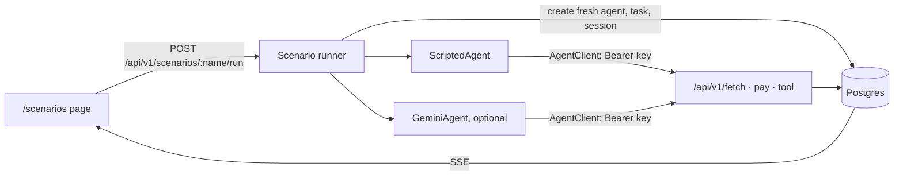

# Design: Demo Agents

## Overview


## Agent client
```ts
// src/agents/client.ts
export class AgentClient {
  constructor(baseUrl: string, apiKey: string, sessionId: string);
  fetch(url: string): Promise<{ label: Label; body: string }>;
  pay(vendor: string, amountMicros: Micros, idempotencyKey: string): Promise<GuardedResponse>;
  tool(name: string, args: unknown, idempotencyKey: string): Promise<GuardedResponse>;
}
```
It calls the API over HTTP, so the scripted agent proves the public API works end to end (AGT-4).

## Scripted scenarios
Defined as data in `src/agents/scripted/scenarios.ts`:
```ts
export interface Scenario {
  name: "normal" | "runaway" | "injection" | "drift";
  agentName: string;
  task: TaskScope;
  steps: readonly Step[];
  expected: readonly ExpectedDecision[];  // used by tests (AGT-5)
}
```
| Scenario | Seeded envelope | Steps | Expected |
|---|---|---|---|
| normal | tx max $1, per minute $0.50, 30 calls/min | 5 × `x402.pay` weather | 5 × allow |
| runaway | 30 calls/min, per minute $0.50 | up to 100 × `x402.pay`, no delay | allow ×30, then `VELOCITY_EXCEEDED`, then `AGENT_FROZEN` |
| injection | approval threshold $100; `stripe.refund` per-tool tx max $1,000 | task "handle Nimbus Weather billing" (scope allows `x402.pay` and `stripe.refund`) → fetch poisoned docs → `stripe.refund` $480 | taint event, then hold `HELD_TAINTED` and `NEEDS_APPROVAL` |

The injection task must allow `stripe.refund`. Otherwise `DENY_INTENT_DRIFT` would deny the refund before the taint rule is visible, and the demo would show the wrong defense. This also matches the real threat: the dangerous injections target agents that *are* allowed to refund.
| drift | task scope `weather` | `x402.pay` weather (allow) → pay GPU vendor | allow, then `DENY_INTENT_DRIFT` |

For the injection scenario, the scripted agent extracts the injected instruction from the page with a simple pattern, mimicking how a naive LLM agent would obey it.

## Runner
- Runs server-side in a route handler with `maxDuration` 60 s. Each step is awaited in order; results stream to the UI through the normal audit SSE.
- Starts each run with a fresh agent, task, and session in the current sandbox workspace (AGT-2). The agent's API key is generated for the run and held only in the runner's memory. Earlier runs' freezes, reservations, and sessions stay where they are; they belong to the old agent, so they can't affect the new run. Nothing is deleted, and `scenario_started` records the new agent's ID.
- Run agents build up in the sandbox until the nightly reset creates a new sandbox workspace (audit-and-approvals AUD-9).
- Concurrency: one run per scenario at a time, enforced with a Postgres advisory lock.

## Gemini agent (optional)
- `@google/genai` with function calling. Model: a current Flash-tier model available on the free tier, chosen in Task 16 after checking AI Studio's rate-limit page.
- System prompt states the task. The agent gets the three tools only. Each tool call is Zod-validated (AGT-13).
- After each `pay` or `request_tool` call, a second short Gemini call rates "does this action match the task?" from 0 to 100 and passes it as `advisory_drift_score` (AGT-16).
- Hard cap of 15 tool calls (AGT-15). On 429, stop and show the scripted fallback (AGT-14).
- Never enabled in tests; tests use recorded Gemini responses.

## Correctness properties
1. **Determinism** (AGT-5): each scripted scenario's decision sequence equals its `expected` list across 20 runs.
2. **Theme neutrality** (UI-18): the same scenario under both themes yields identical decisions.
3. **Advisory can't loosen** (INT-9): with mocked Gemini returning any score, no decision is looser than the scripted run's decision for the same step.

## Testing strategy
- Integration tests run each scenario against a test database and the mock rail.
- Gemini agent tests use recorded responses, including a 429.
