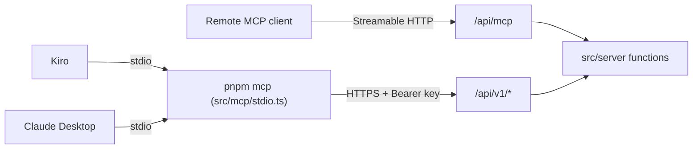

# Design: MCP Server

## Overview

- **stdio server**: a small Node process that calls the deployed AgentVault HTTP API with the agent key. It holds no database credentials, which keeps secrets off the developer's machine.
- **HTTP server**: `/api/mcp` on the deployment calls `src/server` functions directly.
- Both use `@modelcontextprotocol/sdk` and share tool definitions in `src/mcp/tools.ts`.

Tool names use underscores (`agentvault_pay`) because some clients reject dots in tool names.

## Tools
| Tool | Input | Maps to |
|---|---|---|
| `agentvault_pay` | `vendor`, `amount` (decimal dollars string), `session_id`, `idempotency_key?` | `POST /api/v1/pay` |
| `agentvault_fetch` | `url`, `session_id` | `POST /api/v1/fetch` |
| `agentvault_request_tool` | `tool`, `args`, `session_id`, `idempotency_key?` | `POST /api/v1/tool` |

`amount` is converted with `fromDecimalString` (money steering rules). A missing idempotency key is generated from a hash of the input plus a timestamp bucket, so the same input in the same bucket is a replay, not a 422 (audit-and-approvals PXY-12).

There are no approve, deny, or unfreeze tools (MCP-11). Those endpoints reject agent keys with 403 anyway (HITL-10), so a tool could never work; leaving it out also keeps the client model from trying.

A result with `rail_status: "unknown"` (HTTP 202) gets a fixed explanation from `copy.ts` (MCP-12): the payment may have gone through, it is still counted against the budget, and the agent should retry only with the same idempotency key.

Result format:
```json
{ "decision": "hold", "reasons": ["HELD_TAINTED"], "explanation": "Held: …", "approval_id": "apr_…", "approve_at": "https://…/approvals/apr_…" }
```

## Client config examples
Kiro (`.kiro/settings/mcp.json` in the user's project):
```json
{ "mcpServers": { "agentvault": { "command": "npx", "args": ["-y", "tsx", "src/mcp/stdio.ts"], "env": { "AGENTVAULT_URL": "https://<deployment>", "AGENTVAULT_API_KEY": "av_test_…" } } } }
```
The key goes in the user's local config, never in the repo. This repo's own `.kiro/settings/mcp.json` (if added) must reference an environment variable, not a literal key.

## Correctness properties
1. **Parity** (MCP-9): for any generated request and state, the MCP tool result's decision equals the HTTP API's decision.
2. **No human-only tools** (MCP-11): the `tools/list` response contains exactly the three tools from MCP-1.

## Testing strategy
- Integration tests using the SDK's in-memory client transport against the HTTP-mode server with a test database, including a mock rail timeout to check the MCP-12 wording.
- Manual check: connect from Kiro, call `agentvault_pay`, see the event in the dashboard. Record it for the write-up and video.
