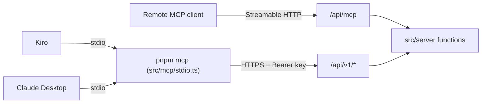

# Design: MCP Server

## Overview

- **stdio server**: a small Node process (`pnpm --silent mcp`; `--silent` keeps pnpm's script line off stdout, which carries the protocol) that calls the deployed AgentVault HTTP API with the agent key. It holds no database credentials, which keeps secrets off the developer's machine. `AGENTVAULT_URL` must be https, or http://localhost.
- **HTTP server**: `/api/mcp` on the deployment. Stateless: each POST gets its own server and transport and a JSON answer. GET and DELETE are 405, since the SDK would otherwise hold an empty event stream open. Bodies over 64 KiB are 413.
- Both use `@modelcontextprotocol/sdk` (1.32.2) and share tool definitions in `src/mcp/tools.ts`. Each tool call becomes one request through `AgentClient`. stdio sends it over HTTPS; `/api/mcp` sends it to the pay, tool, or fetch route handler in the same process with the caller's bearer key. Both paths therefore run the same handler code as the HTTP API, which is what makes parity (MCP-9) hold by construction and what property 1 checks.
- `src/mcp` may not import `src/server` or `src/rails` (lint rule). It reads its wording from `src/ui/copy.ts`, always in the default theme.

## Getting a key and a session
Every tool call needs a `session_id`, and a session needs a task. Nothing else hands one out: agents created in the dashboard get no session, and scenario agents keep their keys in memory. `pnpm mcp:agent [--preset billing|weather] [--name <name>]` (`src/server/mcp/provision.ts`) creates an agent, a task, and a session in the current sandbox in one transaction, appends an `mcp_agent_created` audit event with the scope, and prints the key and session ID once. The task scope is a seeded preset chosen by the person running the script, never by the agent. The sandbox uses mock rails, and the nightly reset revokes the key. A self-serve path (an endpoint where an agent picks a task a person created) is future work.

Tool names use underscores (`agentvault_pay`) because some clients reject dots in tool names.

## Tools
| Tool | Input | Maps to |
|---|---|---|
| `agentvault_pay` | `vendor`, `amount` (decimal dollars string), `rail?` (`x402` default, or `mpp`), `session_id`, `idempotency_key?` | `POST /api/v1/pay` with tool `x402.pay` or `mpp.pay` |
| `agentvault_fetch` | `url`, `session_id` | `POST /api/v1/fetch` |
| `agentvault_request_tool` | `tool`, `args`, `session_id`, `idempotency_key?` | `POST /api/v1/tool` |

Inputs are strict: unknown fields are rejected. `amount` is converted with `fromDecimalString` (money steering rules); in `args`, a dollar `amount` becomes `amount_micros`, and sending both is refused. A missing idempotency key is `mcp_` plus 40 hex digits of SHA-256 over the tool, the input (keys sorted), and the current minute, so the same input in the same minute is a replay, not a 422 (audit-and-approvals PXY-12). The same input in the next minute is a new request; that errs toward not charging twice within a minute, not across a minute boundary. Results include the key used, so a retry can reuse it.

Errors that carry no decision are tool errors (`isError: true`): a missing or rejected key (MCP-7), an invalid amount, a request the API refused before checking it (shown with its status and code), and an API that couldn't be reached. The last one warns that a payment may still have run, because a request that timed out may have been processed.

There are no approve, deny, or unfreeze tools (MCP-11). Those endpoints reject agent keys with 403 anyway (HITL-10), so a tool could never work; leaving it out also keeps the client model from trying.

A result with `rail_status: "unknown"` (HTTP 202) gets a fixed explanation from `copy.ts` (MCP-12): the payment may have gone through, it is still counted against the budget, and the agent should retry only with the same idempotency key.

Result format (`structuredContent`, also as JSON text; validated against the tool's output schema):
```json
{ "decision": "hold", "reasons": ["HELD_TAINTED"], "explanation": "Held: …", "idempotency_key": "mcp_…", "approval_id": "…", "approve_at": "https://…/approvals" }
```
`approve_at` is the inbox, since there's no page per approval. Fetch results put a `[TRUSTED]` or `[UNTRUSTED]` notice in the first content block and the page body in the second (MCP-5).

## Client config examples
Kiro (`.kiro/settings/mcp.json` in the user's project):
```json
{ "mcpServers": { "agentvault": { "command": "npx", "args": ["-y", "tsx", "src/mcp/stdio.ts"], "env": { "AGENTVAULT_URL": "https://<deployment>", "AGENTVAULT_API_KEY": "av_test_…" } } } }
```
The key goes in the user's local config, never in the repo. This repo's own `.kiro/settings/mcp.json` (if added) must reference an environment variable, not a literal key.

## Correctness properties
1. **Parity** (MCP-9): for any generated request and state, the MCP tool result's decision equals the HTTP API's decision.
2. **No human-only tools** (MCP-11): the `tools/list` response contains exactly the three tools from MCP-1.

## Testing strategy
- Integration tests using the SDK's in-memory client transport against the HTTP-mode server with a test database, including a mock rail timeout to check the MCP-12 wording.
- Manual check: connect from Kiro, call `agentvault_pay`, see the event in the dashboard. Record it for the write-up and video.
