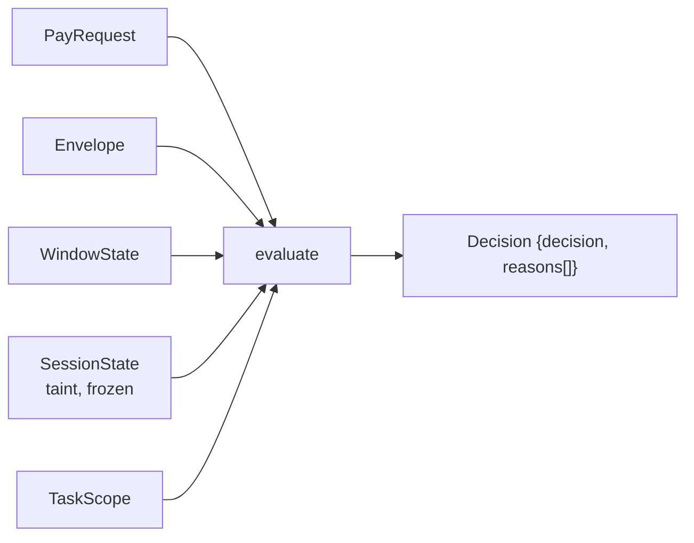

# Design: Money and Policy Core

## Overview
Two pure modules in `src/core`:
- `src/core/money`: the `Micros` type, parsing, arithmetic, display, and rail conversion.
- `src/core/policy`: `evaluate()`, which takes a request and all state as arguments and returns a decision.

Neither module reads the clock, the database, or the network. The server layer (`src/server`) loads state, calls `evaluate()` inside a locked transaction, and writes the audit event. See `audit-and-approvals/design.md` for that flow.



## Money module

```ts
// src/core/money/micros.ts
export type Micros = bigint & { readonly __brand: "Micros" };
export const MAX_MICROS: Micros;
export function micros(v: bigint): Micros;
export function fromDecimalString(s: string): Micros;
export function fromMicrosString(s: string): Micros;
export function toMicrosString(m: Micros): string;
export function toDecimalString(m: Micros): string;      // "0.0015"
export function toDisplay(m: Micros): string;            // "$0.0015"
export function add(a: Micros, b: Micros): Micros;
export function sub(a: Micros, b: Micros): Micros;
export function sum(xs: readonly Micros[]): Micros;
export function cmp(a: Micros, b: Micros): -1 | 0 | 1;

// src/core/money/rail-units.ts
export type Rail = "stripe" | "x402" | "mock";
export type Direction = "debit" | "credit";
export function toRailUnits(m: Micros, rail: Rail, dir: Direction): bigint;
export function fromRailUnits(units: bigint, rail: Rail): Micros;
export function chargeableMicros(m: Micros, rail: Rail, dir: Direction): Micros; // amount counted against the envelope
```

- `chargeableMicros` returns the rounded-up debit for payments (MON-10) and the unchanged requested amount for credits (MON-11). It never returns less than `m`.
- The `mock` rail converts 1:1, like x402.
- The server passes the **tool's registered rail** (taint-and-intent tool registry), not the adapter that runs it. A sandbox `stripe.refund` therefore rounds like Stripe even though the mock adapter executes it, so sandbox amounts match real ones.

Parsing (`fromDecimalString`) uses the regex `^(0|[1-9]\d*)(\.\d{1,6})?$`, then pads the fraction to 6 digits and builds the `bigint`. No `number` is ever involved.

Zod helper for the wire format:
```ts
export const MicrosSchema = z.string().regex(/^(0|[1-9]\d*)$/).transform(fromMicrosString);
```

## Policy module

### Data models
```ts
// src/core/policy/types.ts
export type Window = "minute" | "hour" | "day";

export interface Limits {
  txMaxMicros?: Micros;
  windowCapsMicros?: Partial<Record<Window, Micros>>;
  callsPerMinute?: number;          // count, not money: number is fine
  approvalThresholdMicros?: Micros;
}

export interface Envelope {
  agentId: string;
  limits: Limits;                              // agent-level
  vendorLimits: Record<string, Limits>;        // ENV-9
  toolLimits: Record<string, Limits>;          // ENV-9
  allowedVendors: readonly string[] | "*";
  allowedTools: readonly string[] | "*";
}

export interface WindowState {
  spentMicros: Record<Window, Micros>;          // agent-level
  vendorSpentMicros: Record<Window, Micros>;    // for this request's vendor
  toolSpentMicros: Record<Window, Micros>;      // for this request's tool
  callsLastMinute: number;                      // excluding this request; counts denied and held calls too (audit-and-approvals design)
}

export interface PayRequest {
  kind: "pay" | "tool";
  agentId: string;
  sessionId: string;
  vendor: string;
  vendorCategory: string;
  tool: string;                   // e.g. "x402.pay", "stripe.refund"
  amountMicros: Micros;           // after chargeableMicros()
  idempotencyKey: string;
}

export interface Decision {
  decision: "allow" | "hold" | "deny";
  reasons: readonly ReasonDetail[];
}
export interface ReasonDetail { code: ReasonCode; detail?: Record<string, string> }
```

`SessionState`, `TaskScope`, and `ToolDef` are defined in `taint-and-intent/design.md`. `EvaluateInput` is `{ request, envelope, window, session, scope, tool, approvedHoldReasons? }`, where `tool` is the registry entry for `request.tool` (its `privileged` flag drives the taint rule). The schema rejects a `tool` whose name differs from `request.tool`. `approvedHoldReasons` is set only on an approval re-run (audit-and-approvals HITL-2): a list of hold codes, and the schema rejects any deny or unknown code. `evaluate()` calls the taint and intent rule functions from those modules.

### Reason codes
```ts
// src/core/policy/reasons.ts
export const DENY_REASONS = [
  "INVALID_REQUEST", "AGENT_FROZEN", "OVER_TX_MAX", "OVER_WINDOW_CAP",
  "VELOCITY_EXCEEDED", "VENDOR_NOT_ALLOWED", "TOOL_NOT_ALLOWED",
  "DENY_INTENT_DRIFT", "OVER_TASK_BUDGET",
] as const;
export const HOLD_REASONS = ["NEEDS_APPROVAL", "HELD_TAINTED", "ADVISORY_DRIFT"] as const;
```

### Algorithm
```ts
export function evaluate(input: EvaluateInput): Decision {
  const parsed = EvaluateInputSchema.safeParse(input);
  if (!parsed.success) return deny("INVALID_REQUEST");
  const reasons = [
    ...frozenRule(input),         // ENV-5
    ...txMaxRule(input),          // ENV-1, ENV-9
    ...windowCapRule(input),      // ENV-2, ENV-9
    ...velocityRule(input),       // ENV-3
    ...allowListRule(input),      // ENV-6, ENV-7
    ...intentRules(input),        // INT-* (taint-and-intent spec)
    ...taintRules(input),         // TAINT-* (taint-and-intent spec)
    ...approvalThresholdRule(input), // ENV-8, only if no deny reason fired
  ];
  return combine(withoutApproved(reasons, input.approvedHoldReasons)); // HITL-2, then ENV-12 precedence
}
```
`withoutApproved` drops a reason only if it is a hold reason whose code is on the approved list. Matching is by code, not detail, so an approved `HELD_TAINTED` covers the session's taint (its source never changes, TAINT-5). A deny reason is never dropped, so an approved request runs only if every other rule still passes (HITL-3, TAINT-9).
Each rule is a pure function `(input) => ReasonDetail[]` and is tested on its own. `combine` applies precedence. The effective limit for ENV-9 is the minimum of the agent-level and the vendor- or tool-level value.

ENV-4 (freezing): `evaluate()` only reports `VELOCITY_EXCEEDED`. The server sets `agents.frozen_at` in the same transaction when it sees that code (audit-and-approvals PXY-10).

ENV-5 (frozen): `frozenRule` reads `SessionState.agentFrozen`. The server fills it from `agents.frozen_at`, read after the envelope lock (audit-and-approvals PXY-11).

## Error handling
- Money functions throw typed errors (`InvalidAmountError`, `AmountOutOfRangeError`). They are programmer errors at the core level; the server maps them to HTTP 400.
- `evaluate()` never throws. Invalid input becomes `deny` with `INVALID_REQUEST`.

## Correctness properties
1. **Round-trip** (MON-2, MON-6): for all `m`, `fromDecimalString(toDecimalString(m)) === m`.
2. **Algebra** (MON-5): `add` is associative and commutative; `sub(add(a, b), b) === a`.
3. **Debit rounding never favors the agent** (MON-7, MON-10): `toRailUnits(m, "stripe", "debit") * 10_000n >= m` and `< m + 10_000n`.
4. **Credit rounding never favors the agent** (MON-8): `toRailUnits(m, "stripe", "credit") * 10_000n <= m`.
5. **Caps hold over sequences** (ENV-1, ENV-2): for any envelope and any sequence of requests, where each allowed request updates the window state, the sum of allowed amounts in any window never exceeds that window's cap.
6. **Precedence** (ENV-12): if `reasons` contains any deny code, `decision === "deny"`.
7. **Determinism** (ENV-13): `evaluate(x)` deep-equals `evaluate(x)`.
8. **Monotonicity** (ENV-14): for any input with decision `deny`, lowering any cap keeps the decision `deny`.
9. **Counted amount never under-counts** (MON-10, MON-11): for all `m`, rails, and directions, `chargeableMicros(m, rail, dir) >= m`.

## Testing strategy
- Unit tests per rule function with requirement IDs in names.
- fast-check properties 1–8 in `*.prop.test.ts` with `numRuns: 1000`.
- A deliberately broken float implementation in a test fixture to show property 3 catching it (demo for the Kiro write-up).
- `pnpm demo:policy` prints a decision table for a sample sequence.
- Example tests, named with their IDs, cover the requirements without a property: MON-1, MON-3, and MON-4 (non-negative `bigint` micros, malformed decimal strings rejected, `number` rejected at compile time) in `src/core/money/micros.test.ts`; MON-9 (x402 units 1:1) in `rail-units.test.ts`; ENV-3 to ENV-11 (calls per minute, the freeze and `AGENT_FROZEN`, vendor and tool allow-lists, the approval threshold, per-vendor and per-tool limits, `allow` with no reasons, every applicable reason code) in `src/core/policy/rules.test.ts` and `evaluate.test.ts`; ENV-15 (invalid inputs denied with `INVALID_REQUEST`) in `schemas.test.ts` and `evaluate.prop.test.ts`.
