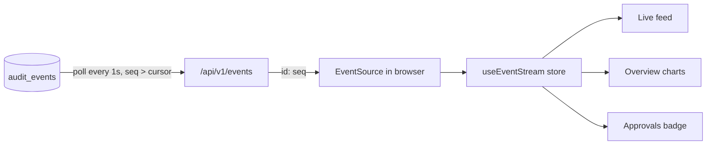

# Design: Telemetry and Dashboard

## Overview
- `app/api/v1/events/route.ts`: SSE stream that polls `audit_events` by cursor.
- `app/(dashboard)/…`: server components for initial data, client components for live parts.
- `src/ui/`: components, theme tokens, `copy.ts`, and the `useEventStream` hook.



## SSE endpoint
- Runtime: Node.js. `export const maxDuration = 60` (or the plan's limit).
- Loop: `SELECT … WHERE workspace_id = $1 AND seq > $2 ORDER BY seq LIMIT 200`, emit each as `id: <seq>\nevent: audit\ndata: <json>\n\n`, sleep 1 s. After a full batch, poll again without sleeping.
- Heartbeat `: ping` after 10 s without a write, so the gap stays under 15 s (TEL-3) even with one poll interval and a slow query on top. No new poll starts after `maxDuration - 5 s`; then the stream ends (TEL-4). Each connection starts with `retry: 1000`. `EventSource` reconnects with `Last-Event-ID` automatically (TEL-2). A malformed `Last-Event-ID` is 400.
- Payloads carry amounts as micros strings. `data` is the stored event: `workspace_id`, `seq`, `type`, `created_at`, `payload`, `prev_hash`, `hash`.
- **Why the cursor can't skip:** `appendEvent` holds the workspace's audit head lock until commit, so a workspace's events commit in `seq` order. A query that sees `seq = n` sees every lower `seq`, and an event committed during a poll is picked up by the next one.
- **Workspace (TEL-5):** `?workspace_id=` names it. Any sandbox, current or retired, is public to read; other workspaces need their owner signed in (401 or 403). Without the parameter, the reader gets the same workspace as the approvals list: their own, or the current sandbox. Any `Authorization` header is 403 `AGENT_KEY_FORBIDDEN`, as on the other dashboard routes.
- After the first poll that returns less than a full batch, the stream sends an id-less `event: ready` with the cursor, so the client can tell an empty workspace from one still loading (UI-15).
- Each connection's second message is `event: workspace` with `{ workspace_id, sandbox, retired }` and no `id`, so it doesn't move the browser's last event ID. `useEventStream` reconnects with that `workspace_id`, so a `Last-Event-ID` is never applied to another workspace's chain after a sandbox reset, and reloads when `retired` is true.
- Opening a sandbox stream counts toward a per-IP limit (30 per minute), because each stream holds a function for up to 55 s.
- Code: the loop is `pumpEvents()` in `src/server/events/stream.ts`, with the event source and clock injected; the handler is `src/server/events/handler.ts`.

### Pending approvals count (UI-22)
- `usePendingCount`, called once by the sidebar for both navigation bars, calls `GET /api/v1/approvals?status=pending`, which applies expiry first, when the pathname changes and when the tab becomes visible. One request per navigation; no stream and no timer, so it adds nothing while a tab sits open (TEL-6, TEL-7).
- The list is capped at 100, so 100 or more shows `99+`. Zero, a failed request, or a non-200 answer shows nothing; a count is a hint, and the inbox is the source of truth.
- The number is visible, followed by screen-reader text ("waiting for approval", Kiroween: "awaiting judgment"), so the link reads "Approvals 3 waiting for approval". Both navigation bars show it.
- Known gap: approving inside the inbox doesn't update the count until the next navigation.

### Pausing the stream (TEL-6, TEL-7)
- All in `useEventStream`, on the client. The server doesn't change, so a client that never pauses costs what it did before.
- The hook is *active* while `document.visibilityState` is `visible` and the page isn't idle. Becoming inactive closes the `EventSource` and sets status `paused`. Becoming active opens a new one.
- The new `EventSource` can't send `Last-Event-ID` (the browser sets it only on its own reconnects), so it receives the workspace's backlog again. `mergeEvents` keeps each `seq` once and in order, so the events missed while paused appear and nothing repeats (property 1 still holds). A day's sandbox backlog is a few hundred events, the same as a page load.
- Idle: a timer of `idleMs` (15 minutes) restarts on `pointerdown`, `pointermove`, `keydown`, `wheel`, and `touchstart` on `window`, at most once a second. When it fires, the hook pauses. Any of those inputs, or the badge's Resume button, resumes. Becoming visible counts as input.
- `StreamStatusBadge` shows "Live updates paused" for `paused`, with a Resume button next to it; the status text stays in the `role="status"` region so screen readers hear the change. Copy in both themes.
- `idleMs` and the document are injectable for tests.

## Pages
| Route | Content |
|---|---|
| `/` | Overview: KPI cards (spend, blocked spend, held, agents frozen), spend-over-time area chart, decisions bar chart, recent alerts |
| `/feed` | Live feed table with filters (agent, decision, reason) |
| `/agents` | Agent list, create agent dialog (key shown once with copy button), unfreeze |
| `/agents/[id]` | Envelope editor (React Hook Form + Zod), per-vendor and per-tool limits |
| `/approvals` | Inbox cards with reason explanations and countdown |
| `/audit` | Paginated events, hash column (truncated), "Verify chain" |
| `/scenarios` | Scenario runner (demo-agents spec) |
| `/settings` | Theme toggle, workspace info, trusted origins |

Navigation: left sidebar on desktop, and a navigation bar fixed to the bottom of the screen below the `md` breakpoint (one tap to every page at 375 px). Components follow the shadcn/ui style (`Card`, `Badge`, `Button`) but are written in `src/ui/components/primitives.tsx`, so there's no Radix dependency. Dialogs use the native `<dialog>` element, which handles focus, Escape, and the inert background. Status messages use `role="status"` live regions instead of toasts.

Built in Phase 10: `/`, `/feed`, `/agents`, `/agents/[id]`, `/approvals`. Phase 11 added `/scenarios`, which always streams the current sandbox. Phase 15 added `/settings` with the Kiroween switch only; workspace info and trusted origins aren't built. Phase 12 added `/audit`: 50 events a page, newest first, paged by `?before=<seq>` on the server, and "Verify chain", which calls `POST /api/v1/audit/verify`. The rest arrive with their tasks.

`POST /api/v1/audit/verify` takes `{ workspace_id? }` and has the event stream's read access: any sandbox is public, other workspaces need their owner. It's human-only (403 for any `Authorization` header or a cross-site POST, before the database opens), and sandbox calls are limited to 30 per IP per minute because each reads the whole chain. It returns `{ ok: true, count, head_seq }` or `{ ok: false, broken_at_seq, why, head_seq }`. The approvals count badge in the sidebar isn't built; it would open a second event stream on every page.

### First visit (UI-23, UI-24, UI-25)
Most visitors to the hosted site are judges who land on `/` right after a nightly reset, when every card reads zero. These three changes point them at the demo and make its key moment readable.
- **Start here card (UI-23).** `TourCard` in `src/ui/overview/`, rendered by `OverviewView` above the KPI cards when the page passes `tour`. The overview page passes `tour` only for a sandbox workspace, with `testnet` computed the same way as on `/scenarios` (`testnetRailReady()` and the testnet workspace exists), so step 4 never points at a button that isn't there. The steps are an ordered list of plain links (`/scenarios`, `/approvals`, `/audit`, `/scenarios`), with copy in both themes. It stays while the sandbox has events, so a judge who comes back to the overview can see the next step.
- **Tagline (UI-27).** The header's first line is `app.tagline`, so a visitor from Devpost reads what AgentVault is before anything else. Above the workspace name, as plain text.
- **Header theme switch (UI-24).** `HeaderThemeSwitch` in `src/ui/settings/`: a `button` with `role="switch"` and `aria-checked`, a ghost icon, and the visible label "Kiroween mode". It calls the same `setTheme` as the Settings switch, so the cookie, `data-theme`, and `router.refresh()` behave the same, and UI-18 still holds: no request depends on the theme.
- **Requested payee (UI-25).** `decisionRow` reads `request.args.payee_ref` for a `payee.update` decision, as a string of 1 to 200 characters (anything else is dropped), into `FeedRow.requestedPayee`. The feed row and the scenario step show "Requested payout account: acct_…" as monospace text. Once the change is applied, the feed shows the existing `payeeChange` line (PO-12) instead.

### Tamper simulation (UI-26)
"Verify chain" only ever says verified, so a visitor never sees a check fail. The audit page gets a "Try to tamper with it" card that breaks a copy on purpose.
- **Where it runs.** In the browser, on the page's events (at most 50, a contiguous run of `seq`). No request is sent and nothing is stored, so there is no new endpoint, rate limit, or database access, and the append-only log (AUD-3) is untouched.
- **Core.** `verifySegment(workspaceId, events)` in `src/core/audit/chain.ts`: the `verifyNext()` checks over a contiguous run, starting from the first row's own `prev_hash` and `seq`. It can't check the head, because the head key never leaves the server; the card says so.
- **The edits** (`src/ui/audit/tamper.ts`, pure). The target is the newest `decision` held or denied on the page, else the newest decision, else the newest event. "Rewrite an event" changes the copy's payload: a decision becomes `allow` with no reasons, anything else gains `tampered: true`. "Delete an event" removes a row strictly inside the run (the target if it is, else the middle row), because removing the first or last row of a page leaves a shorter run that still links; only the server's head check catches a deleted tail. Delete needs at least three events.
- **What it shows.** First the untouched copy's result ("Untouched, these N events verify in your browser"); if even that fails, it says the browser couldn't recheck and shows nothing else. Then what changed ("Rewrote seq 41: hold to allow" or "Deleted seq 41") and the result with the existing broken-chain copy (`audit.broken`, `audit.why.*`).

## Reason explanations
`src/ui/copy.ts` maps each reason code to a plain-language sentence per theme:
```ts
export const copy = {
  default: { HELD_TAINTED: "Held: this session read untrusted content, so refunds and payouts need approval.", … },
  kiroween: { HELD_TAINTED: "Sealed in The Crypt: this session is Haunted by an untrusted page.", … },
} satisfies Record<Theme, Record<ReasonCode | UiKey, string>>;
```
The `satisfies` check makes a missing string a compile error.

## Theme system
- `<html data-theme="default|kiroween">`. CSS variables for colors, radius, and fonts in `app/globals.css`.
- **The choice is an `av-theme` cookie** (one year, `Path=/`, `SameSite=Lax`, `Secure` on https), not `localStorage` (UI-17). The root layout reads it with `getTheme()` and renders `data-theme` and the copy for it, so the first paint is already right and no pre-paint script is needed. A `localStorage` script could fix the colors before paint but not the server-rendered copy, which would flash. Any value other than a theme name is the default.
- Copy: `t()` and `reasonText()` take a required theme. Client components get them from `useCopy()` (the `ThemeProvider` context, seeded from the cookie); server components from `getCopy()`. Outcome messages are kept as copy keys and translated when rendered, so they follow a theme change.
- The `/settings` switch writes the cookie, sets `data-theme`, re-renders client components from the context, and calls `router.refresh()` for server components. The Settings link sits with the account controls (sidebar footer, mobile header), so the mobile bar keeps six items.
- UI-18: only layouts, pages, and `src/ui` read the theme. A test checks that nothing under `src/core`, `src/server`, `src/rails`, `src/agents`, `src/mcp`, `app/api`, or `app/vendor` names the cookie or imports `src/ui`, and property 2 runs the scenarios with each cookie value.
- Fonts through `next/font/google` (all under the SIL Open Font License): Inter and JetBrains Mono by default; Creepster for Kiroween `h1` and the app name only (not preloaded), with Inter for body text to keep it readable.
- Kiroween palette: near-black background, pumpkin orange accent, ghost-white text, toxic green for "allowed", with `color-scheme: dark`. Every text and focus pair passes the AA contrast test.
- Decorative touches are CSS only and stop under `prefers-reduced-motion` (UI-19): a faint fog gradient that drifts behind the page, and a skull on The Crypt and a ghost on Haunted badges, hidden from screen readers. Lucide has no bat icon, so frozen agents get the skull.

## Auth and access
- Auth.js v5 with the GitHub provider and the Drizzle adapter. Sessions are JWTs (`session.strategy: "jwt"`), so reading one makes no database query; the adapter writes users and accounts on the OAuth callback only, over Neon's HTTP driver. Sign-in is on only when `AUTH_SECRET`, `AUTH_GITHUB_ID`, and `AUTH_GITHUB_SECRET` are set and aren't the `.env.example` placeholders; otherwise `/api/auth/*` is 404 and everyone is anonymous.
- The dashboard layout resolves the workspace (`loadDashboardContext()`, not middleware, so no database call runs in the proxy layer): signed-in user → their workspace, created on first visit under a per-user advisory lock (UI-2); anonymous → the current sandbox (newest `is_sandbox` workspace with `retired_at IS NULL`). Anonymous visitors can read, run scenarios, approve, deny, and unfreeze there (UI-21, HITL-11). The inbox shows a "Sandbox: mock rails only" note.
- Creating agents (`POST /api/v1/agents`) and saving envelopes (`PUT /api/v1/agents/:id/envelope`) are owner-only, and the sandbox is read-only for both (403 `SANDBOX_READ_ONLY`): visitors shouldn't mint API keys in the shared sandbox or change the limits every visitor's demo runs under. Scenarios get their own fresh agents (demo-agents AGT-2).
- Every human-only POST or PUT refuses a cross-site request (another `Origin` host, or `Sec-Fetch-Site: cross-site`) with 403 `CROSS_ORIGIN` before the database opens. The session cookie is also `SameSite=Lax`. Sign-in and sign-out are server actions, which Next.js origin-checks.
- Envelope saves send the version the editor loaded; a save over a newer version is 409 `ENVELOPE_CHANGED`. Each save appends `envelope_updated` with the actor and the new envelope, after locking the envelope row (the pay flow's lock order). New agents get small limits ($5 per transaction, $20 per day, approval over $1, 30 calls per minute) and payment tools only.
- Nightly reset: Vercel Cron calls `/api/cron/sandbox-reset` (UI-3, AUD-9). Open dashboards keep their SSE connection to the retired workspace, so the client checks the current sandbox ID on reconnect and reloads if it changed.
- Rate limiting: a Postgres-backed fixed window per IP on sandbox mutations (no extra service needed).

## Error handling
- Every data view uses a shared `<DataState>` wrapper for loading, empty, and error states (UI-15).
- The live feed shows a "Reconnecting…" badge while `EventSource` is down.

## Correctness properties
1. **Cursor completeness** (TEL-2): for any sequence of inserts and any reconnect points, the client receives each `seq` exactly once, in order.
2. **Theme neutrality** (UI-18): for every scenario, the recorded decision sequence is identical with `theme = default` and `theme = kiroween`.
3. **Display exactness** (UI-11): for any `Micros`, parsing the displayed string back gives the same value.
4. **Segment tamper detection** (UI-26): for any chain and any contiguous run of it, `verifySegment` accepts the untouched run; a payload edit to any row of the run fails at that row with `why: "hash"`; and deleting any row strictly inside the run fails at that row's `seq` with `why: "gap"`.

## Testing strategy
- Property 1 against a fake event source in the stream module (1,000 runs, with clients dropping at batch boundaries and events committing during polls), and again through the handler with concurrent appends on Postgres; property 3 shared with the money tests.
- Component tests (Vitest + Testing Library) for amount display and the envelope form.
- Playwright: open the sandbox without signing in, run the prompt-injection scenario, approve the held refund in the inbox, see it in the feed, and verify the chain (UI-21, AUD-6). `pnpm test:e2e` (`scripts/e2e.ts`) creates a throwaway database on the `DATABASE_URL_TEST` server with a sandbox signed by a key made for the run, starts `next dev` on port 3100 with that database and key in its environment, and drops the database afterwards. It uses the dev server because the injection scenario fetches its docs page from localhost (TAINT-2).
- Playwright (`tests/e2e/layout-keyboard.spec.ts`): every dashboard page, in both themes, at 375 px and 1920 px, must not scroll sideways (UI-14); a failure names the element that sticks out. Tabbing from the top of the overview at 375 px and 1280 px must reach every navigation link, Settings included, and every focused element must show its focus ring (UI-13). It runs the drift scenario first, so the tables have rows.
- Contrast (UI-12) is checked from the theme tokens in `src/ui/theme.test.ts`: text at 4.5:1 on every background, and focus rings and form-control borders (`control-border`) at 3:1 (WCAG 1.4.11). The lighter `border` token is decorative only.
- Lighthouse accessibility score ≥ 95 on the overview page in both themes (manual check, task 9).
- Example tests, named by requirement ID, cover the rest: TEL-1, TEL-3 to TEL-5 (stream and handler), UI-1 to UI-10 and UI-15 (pages, sandbox access, rate limits, nightly reset), and UI-16, UI-17, UI-19, UI-20 (theme, motion, licensing).
- UI-26: property 4 in `src/core/audit/chain.prop.test.ts` (1,000 runs); unit tests of the target choice and both edits in `src/ui/audit/tamper.test.ts`; component tests that the card shows the untouched result, then the broken `seq` and why, makes no request (the verify API is never called), and leaves the page's events as they were.
- UI-23: component tests: the card's steps in order with their links, step 4 only with `testnet`, and no card without `tour`. UI-24: the header switch reflects and flips the theme through the provider. UI-27: the header shows the tagline in each theme. UI-25: `decisionRow` keeps a valid `payee_ref` only on `payee.update` and drops a non-string or oversized one; the feed and the scenario steps render it as text, not a link. The layout and keyboard end-to-end test covers the header switch at 375 px and 1920 px.
- UI-22: component tests with a fake fetch: the count and its screen-reader text, `99+` at 100, nothing for 0 or a failed request, and one new request per pathname change or return to the tab.
- TEL-6 and TEL-7: hook tests with the fake event source and fake timers. Hiding the page closes the stream; showing it opens one stream, and a replayed backlog adds only the missed events. Fifteen minutes without input closes it and shows the paused badge; input just before the limit keeps it open; Resume and any input reopen it.
