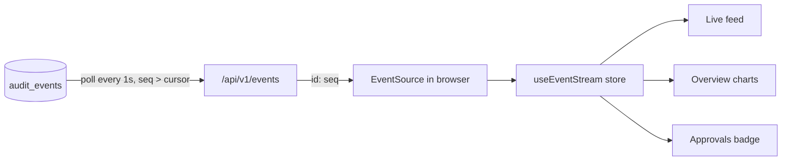

# Design: Telemetry and Dashboard

## Overview
- `app/api/v1/events/route.ts`: SSE stream that polls `audit_events` by cursor.
- `app/(dashboard)/…`: server components for initial data, client components for live parts.
- `src/ui/`: components, theme tokens, `copy.ts`, and the `useEventStream` hook.



## SSE endpoint
- Runtime: Node.js. `export const maxDuration = 60` (or the plan's limit).
- Loop: `SELECT … WHERE workspace_id = $1 AND seq > $2 ORDER BY seq LIMIT 200`, emit each as `id: <seq>\nevent: audit\ndata: <json>\n\n`, sleep 1 s. After a full batch, poll again without sleeping.
- Heartbeat `: ping` after 10 s without a write, so the gap stays under 15 s (TEL-3) even with one poll interval and a slow query on top. No new poll starts after `maxDuration - 5 s`; then the stream ends (TEL-4). Each connection starts with `retry: 1000`. `EventSource` reconnects with `Last-Event-ID` automatically (TEL-2). A malformed `Last-Event-ID` is 400.
- Payloads carry amounts as micros strings. `data` is the stored event: `workspace_id`, `seq`, `type`, `created_at`, `payload`, `prev_hash`, `hash`.
- **Why the cursor can't skip:** `appendEvent` holds the workspace's audit head lock until commit, so a workspace's events commit in `seq` order. A query that sees `seq = n` sees every lower `seq`, and an event committed during a poll is picked up by the next one.
- **Workspace (TEL-5):** `?workspace_id=` names it. Any sandbox, current or retired, is public to read; other workspaces need their owner signed in (401 or 403). Without the parameter, the reader gets the same workspace as the approvals list: their own, or the current sandbox. Any `Authorization` header is 403 `AGENT_KEY_FORBIDDEN`, as on the other dashboard routes.
- Each connection's second message is `event: workspace` with `{ workspace_id, sandbox, retired }` and no `id`, so it doesn't move the browser's last event ID. `useEventStream` reconnects with that `workspace_id`, so a `Last-Event-ID` is never applied to another workspace's chain after a sandbox reset, and reloads when `retired` is true.
- Opening a sandbox stream counts toward a per-IP limit (30 per minute), because each stream holds a function for up to 55 s.
- Code: the loop is `pumpEvents()` in `src/server/events/stream.ts`, with the event source and clock injected; the handler is `src/server/events/handler.ts`.

## Pages
| Route | Content |
|---|---|
| `/` | Overview: KPI cards (spend, blocked spend, held, agents frozen), spend-over-time area chart, decisions bar chart, recent alerts |
| `/feed` | Live feed table with filters (agent, decision, reason) |
| `/agents` | Agent list, create agent dialog (key shown once with copy button), unfreeze |
| `/agents/[id]` | Envelope editor (React Hook Form + Zod), per-vendor and per-tool limits |
| `/approvals` | Inbox cards with reason explanations and countdown |
| `/audit` | Paginated events, hash column (truncated), "Verify chain" |
| `/scenarios` | Scenario runner (demo-agents spec) |
| `/settings` | Theme toggle, workspace info, trusted origins |

Navigation: left sidebar on desktop, bottom sheet on mobile. Components from shadcn/ui: `Card`, `Table`, `Dialog`, `Badge`, `Button`, `Form`, `Tabs`, `Sonner` toasts.

## Reason explanations
`src/ui/copy.ts` maps each reason code to a plain-language sentence per theme:
```ts
export const copy = {
  default: { HELD_TAINTED: "Held: this session read untrusted content, so refunds and payouts need approval.", … },
  kiroween: { HELD_TAINTED: "Sealed in The Crypt: this session is Haunted by an untrusted page.", … },
} satisfies Record<Theme, Record<ReasonCode | UiKey, string>>;
```
The `satisfies` check makes a missing string a compile error.

## Theme system
- `<html data-theme="default|kiroween">`. CSS variables for colors, radius, and fonts in `app/globals.css`.
- A tiny inline script in `<head>` reads `localStorage` before paint to avoid a flash (UI-17).
- Fonts through `next/font/google` (all under the SIL Open Font License): Inter and JetBrains Mono by default; Creepster for Kiroween headings only, with Inter for body text to keep it readable.
- Kiroween palette: near-black background, pumpkin orange accent, ghost-white text, toxic green for "allowed." Check every pair for AA contrast.
- Decorative touches (subtle fog gradient, bat icon on frozen agents) are CSS only and disabled under `prefers-reduced-motion`.

## Auth and access
- Auth.js v5 with the GitHub provider and the Drizzle adapter.
- Middleware resolves the workspace: signed-in user → their workspace; anonymous → the current sandbox (newest `is_sandbox` workspace with `retired_at IS NULL`). Anonymous visitors can read, run scenarios, approve, deny, and unfreeze there (UI-21, HITL-11). The inbox shows a "Sandbox: mock rails only" note.
- Nightly reset: Vercel Cron calls `/api/cron/sandbox-reset` (UI-3, AUD-9). Open dashboards keep their SSE connection to the retired workspace, so the client checks the current sandbox ID on reconnect and reloads if it changed.
- Rate limiting: a Postgres-backed fixed window per IP on sandbox mutations (no extra service needed).

## Error handling
- Every data view uses a shared `<DataState>` wrapper for loading, empty, and error states (UI-15).
- The live feed shows a "Reconnecting…" badge while `EventSource` is down.

## Correctness properties
1. **Cursor completeness** (TEL-2): for any sequence of inserts and any reconnect points, the client receives each `seq` exactly once, in order.
2. **Theme neutrality** (UI-18): for every scenario, the recorded decision sequence is identical with `theme = default` and `theme = kiroween`.
3. **Display exactness** (UI-11): for any `Micros`, parsing the displayed string back gives the same value.

## Testing strategy
- Property 1 against a fake event source in the stream module (1,000 runs, with clients dropping at batch boundaries and events committing during polls), and again through the handler with concurrent appends on Postgres; property 3 shared with the money tests.
- Component tests (Vitest + Testing Library) for amount display and the envelope form.
- Playwright: open the sandbox without signing in, run the prompt-injection scenario, approve the held refund in the inbox, see it in the feed (UI-21).
- Lighthouse accessibility score ≥ 95 on the overview page in both themes (manual check, task 9).
